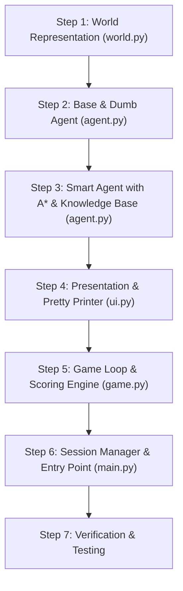

# Wumpus World — Implementation Specification & Step-by-Step Guide

## 1. Project Analysis & Architectural Vision

Based on `plan.txt` and user requirements, this project implements an autonomous Wumpus World simulation in Python. The design strictly emphasizes:
- **Beginner Readability**: Pure OOP with clear class responsibilities and zero spaghetti code.
- **Strict Decoupling of UI/UX**: The core logic (World, Agent, Game) does not contain complex rendering code. All ASCII formatting, borders, legends, and colored logs are isolated in `ui.py`. Beginners can inspect or modify algorithms without touching presentation code.
- **Replayable World Sessions**: The user can generate a world, watch Dumb or Smart Agent solve it, and then retry the **exact same world layout** with a different or same agent mode to compare behaviors directly.
- **Configurable Grid**: Configurable grid dimensions (default 4×4).
- **Visited Tracking for Both Agents**: Even the Dumb Agent tracks visited tiles to avoid infinite loops.
- **Arrow / Shoot Mechanic**: Agent has 1 arrow. Shooting can test or eliminate the Wumpus. Per requirements, slaying the Wumpus triggers a victory condition.

> **Coverage Check (plan.txt vs implement.md):**
> All `!` (must implement) and `*` (prioritize) items from `plan.txt` are satisfied:
> automatic agent play, beginner-readable OOP, file separation, Python, pretty-print
> every step, final state on win/loss, final score, dumb agent, smart A* agent with
> explanatory reasoning. Extras added: session replay, configurable grid, shoot mechanic.

---

## 2. Decoupled Architecture

```
wumpus/
│
├── world.py        # CORE: Grid dimensions, hazards, percept calculation, shooting resolution
├── agent.py        # CORE: Agent base class, DumbAgent (loop-safe random), SmartAgent (A* + KB)
├── game.py         # CORE: Game loop, turn resolution, scoring rules, win/loss checks
├── ui.py           # PRESENTATION ONLY: ASCII grid rendering, step logs, menus (Beginner-safe to ignore)
├── main.py         # APPLICATION: Session loop (Play -> Mode -> Replay Same World / New World / Exit)
└── implement.md    # Guide & Step-by-step progress tracking
```

---

## 3. Game Rules & Scoring

| Event / Action | Result / Score Effect |
| :--- | :--- |
| **Grid Size** | Configurable at start (default 4×4) |
| **Start Position** | Always `(0, 0)`, facing **East** |
| **Action Cost** | -1 point per action (Move, Turn Left, Turn Right, Grab, Shoot) |
| **Grab Gold** | **Win!** (+1000 points) → Game Ends |
| **Kill Wumpus with Arrow** | **Win / Safe!** (+1000 points) → Game Ends |
| **Fall into Pit** | **Death!** (-1000 points) → Game Ends |
| **Step onto live Wumpus** | **Death!** (-1000 points) → Game Ends |
| **Shoot Arrow (Miss/Use)** | -10 points, consumes single arrow |
| **Bump into Wall** | Agent stays in place, receives `bump` percept |

---

## 4. UI/UX Separation Strategy

To ensure beginners can learn algorithms without being intimidated by complex string manipulation:
1. **Model-View Pattern**: `Game` and `Agent` produce plain Python data dictionaries:
   ```python
   # Example snapshot generated by game.py
   step_data = {
       "step": 4,
       "agent_pos": (0, 1),
       "agent_dir": "NORTH",
       "percepts": {"stench": False, "breeze": True, "glitter": False},
       "thought": "Tile (0,2) has breeze; marking neighbors as potential pits.",
       "action": "TURN_LEFT",
       "score": -4
   }
   ```
2. **`ui.py` consumes this dictionary**:
   - Renders the grid with box characters (`┌─┬─┐`).
   - Renders the step log: `[PERCEPT]`, `[THINK]`, `[ACTION]`, `[SCORE]`.
3. If a student wants to see how A* or state works, they only read `agent.py` and `world.py`.

---

## 5. Step-by-Step Building Progress



### Step 1: World Representation (`world.py`)
- Define `Direction` constants: `NORTH`, `EAST`, `SOUTH`, `WEST` with delta offsets `(dr, dc)`.
- Class `World`:
  - `__init__(rows=4, cols=4, seed=None)`: Supports deterministic seed for replayability.
  - Setup positions: Agent `(0, 0)`, Wumpus, Pits (count scaled by grid size, e.g., 3 for 4x4), Gold.
  - `clone()`: Method to produce an exact identical copy of the initial world for the **"Retry same world"** feature.
  - `get_percepts(pos, just_bumped, scream_heard) -> dict`: Returns `{stench, breeze, glitter, bump, scream}`.
  - `resolve_arrow(from_pos, direction) -> bool`: Checks if arrow trajectory hits the Wumpus.
  - `is_valid(pos)`: Boundary check.

### Step 2: Base Agent & Loop-Safe Dumb Agent (`agent.py` - Part 1)
- Abstract Base Class `Agent`:
  - Attributes: `pos`, `direction`, `has_arrow`, `has_gold`, `visited_tiles` (set of `(r, c)`), `score`.
  - Methods: `turn_left()`, `turn_right()`, `get_forward_pos()`.
- Class `DumbAgent(Agent)`:
  - Tracks `visited_tiles` to avoid ping-ponging between two tiles.
  - Decision Logic:
    1. If `glitter` is perceived, choose `GRAB`.
    2. Prioritizes unvisited adjacent tiles when choosing to move forward.
    3. If all adjacent choices are visited, falls back to random rotation/move to escape local traps.
    4. Explains its simple thought process in plain English.

### Step 3: Smart Agent with A* & Knowledge Base (`agent.py` - Part 2)
- Class `KnowledgeBase`:
  - Per tile memory: `SAFE`, `POSSIBLE_PIT`, `POSSIBLE_WUMPUS`, `CONFIRMED_PIT`, `CONFIRMED_WUMPUS`, `VISITED`.
  - Deduction rules:
    - If tile has no breeze and no stench: All adjacent neighbors are 100% `SAFE`.
    - Cross-referencing breezes and stenches to deduce exact hazard coordinates.
- Class `SmartAgent(Agent)`:
  - **A\* Path Planning**:
    - Navigates through known safe tiles to reach unvisited frontiers or the gold tile.
    - Path heuristic: Manhattan distance $h(n) = |r_1 - r_2| + |c_1 - c_2|$ plus turn cost estimation.
  - **Strategic Shooting**:
    - If Wumpus location is deduced or suspected blocking the path to gold, fires arrow in that direction.
  - **Explanatory Reasoning Generation**:
    - Generates human-friendly explanations (e.g., *"Chose tile (1,2) because it is verified safe with 0 hazard percepts nearby"*).

### Step 4: UI & Pretty Printing (`ui.py`)
- Independent presentation module containing:
  - `render_grid(world, agent_pos, agent_dir, visited_tiles, reveal_all=False)`:
    - Clean ASCII / Unicode table format.
    - Direction indicators (`▲`, `►`, `▼`, `◄`).
    - Hazard indicators (`W` for Wumpus, `P` for Pit, `G` for Gold, `~` for Breeze, `*` for Stench).
  - `render_step_log(step_num, percepts, thought, action, score)`:
    - Structured color-coded tags: `[PERCEPT]`, `[THINK]`, `[ACTION]`, `[RESULT]`.
  - `render_banner(title)`, `render_game_over(status, score, steps)`.

### Step 5: Game Loop & Scoring Engine (`game.py`)
- Class `Game`:
  - Orchestrates interaction between `World`, `Agent`, and `UI`.
  - Turn Execution:
    1. World emits percepts for agent's current tile.
    2. Agent perceives and produces an `action` + `reasoning`.
    3. Game applies action (updates pos, orientation, or inventory).
    4. Evaluates end conditions:
       - Fell in Pit (`LOSE`)
       - Eaten by Wumpus (`LOSE`)
       - Grabbed Gold (`WIN`)
       - Slew Wumpus with Arrow (`WIN`)
       - Max steps safety cap (configurable, e.g., 100)
    5. Calls `ui.render_step(...)` with clean data payload.
  - Returns final summary: Win/Loss status, final score, step count.

### Step 6: Session Manager & Entry Point (`main.py`)
- Interactive CLI flow:
  ```
  === WUMPUS WORLD ADVENTURE ===
  1. Configure Grid (Rows, Cols - default 4x4)
  2. Pick Agent Mode:
     [1] Dumb Agent (Loop-safe random)
     [2] Smart Agent (Knowledge Base + A* Search)
  --> Watch game execute step-by-step (with adjustable delay or press-enter)
  --> Final state & score displayed
  
  [Game Finished] What would you like to do?
  [1] Replay THIS SAME world (Try another agent or test consistency)
  [2] Start a NEW random world
  [3] Exit
  ```

### Step 7: Verification & Testing
- Unit test coverage for:
  - World percept generation (border cases, corners).
  - Loop prevention in Dumb Agent.
  - Deductive safety reasoning and A* path finding in Smart Agent.
  - Replay session consistency: Verifying the same world layout is preserved across a replay.

---


## 6. Agent Task Checklist

> Each step below is assigned to a dedicated agent. Check off each sub-task when complete.

---

### 🗂️ Step 1 — World Representation (`world.py`)

**Agent:** `world-agent`

- [x] Define `Direction` constants: `NORTH`, `EAST`, `SOUTH`, `WEST` with delta offsets `(dr, dc)`
- [x] Class `World.__init__(rows=4, cols=4, seed=None)` — supports deterministic seed for replayability
- [x] Place Agent start position at `(0, 0)` facing `EAST`
- [x] Randomly place Wumpus (one tile, not `(0,0)`)
- [x] Randomly place Pits (count scaled by grid size, e.g., 3 for 4×4, not `(0,0)`)
- [x] Randomly place Gold (not on `(0,0)`, Wumpus, or Pit)
- [x] `World.clone()` — exact deep copy of initial state for replay sessions
- [x] `World.get_percepts(pos, just_bumped, scream_heard) -> dict` — returns `{stench, breeze, glitter, bump, scream}`
- [x] `World.resolve_arrow(from_pos, direction) -> bool` — checks if arrow trajectory hits Wumpus
- [x] `World.is_valid(pos)` — boundary check
- [x] Verified: percepts correct for corner and edge tiles

---

### 🤖 Step 2 — Base Agent & Loop-Safe Dumb Agent (`agent.py` — Part 1)

**Agent:** `agent-dumb-agent`

- [x] Abstract Base Class `Agent` with attributes: `pos`, `direction`, `has_arrow`, `has_gold`, `visited_tiles` (set of `(r, c)`), `score`
- [x] `Agent.turn_left()` — update direction
- [x] `Agent.turn_right()` — update direction
- [x] `Agent.get_forward_pos()` — return next position given current direction
- [x] Class `DumbAgent(Agent)`
- [x] DumbAgent: if `glitter` perceived → choose `GRAB`
- [x] DumbAgent: prefer unvisited adjacent tiles when choosing `MOVE_FORWARD`
- [x] DumbAgent: if all adjacent are visited → random rotate/move to escape local trap
- [x] DumbAgent: produces plain-English `thought` string explaining its decision

---

### 🧠 Step 3 — Smart Agent with A\* & Knowledge Base (`agent.py` — Part 2)

**Agent:** `agent-smart-agent`

- [x] Class `KnowledgeBase` with per-tile states: `SAFE`, `POSSIBLE_PIT`, `POSSIBLE_WUMPUS`, `CONFIRMED_PIT`, `CONFIRMED_WUMPUS`, `VISITED`
- [x] KB deduction rule: no breeze + no stench on tile → all adjacent neighbors are `SAFE`
- [x] KB deduction rule: cross-reference breezes and stenches to deduce exact hazard coordinates
- [x] Class `SmartAgent(Agent)` — uses `KnowledgeBase`
- [x] SmartAgent: A\* path planning through known-safe tiles to unvisited frontiers or gold
- [x] SmartAgent: A\* heuristic — Manhattan distance + turn cost estimation
- [x] SmartAgent: strategic shooting — fire arrow when Wumpus location deduced or suspected
- [x] SmartAgent: explanatory `thought` string (e.g., *"Chose tile (1,2) because it is verified safe with 0 hazard percepts nearby"*)

---

### 🖥️ Step 4 — UI & Pretty Printer (`ui.py`)

**Agent:** `ui-agent`

- [x] `render_grid(world, agent_pos, agent_dir, visited_tiles, reveal_all=False)` — Unicode box-drawing table
- [x] Grid shows direction indicator: `▲` `►` `▼` `◄` for agent position
- [x] Grid shows hazard indicators: `W` Wumpus, `P` Pit, `G` Gold, `~` Breeze, `*` Stench
- [x] `render_step_log(step_num, percepts, thought, action, score)` — color-coded `[PERCEPT]` `[THINK]` `[ACTION]` `[RESULT]` tags
- [x] `render_banner(title)` — decorative header for session start
- [x] `render_game_over(status, score, steps)` — final state display on win or death
- [x] All rendering functions accept plain dict/data — no direct dependency on game logic

---

### ⚙️ Step 5 — Game Loop & Scoring Engine (`game.py`)

**Agent:** `game-agent`

- [x] Class `Game` — orchestrates `World`, `Agent`, and `UI`
- [x] Turn loop: World emits percepts → Agent produces `action` + `thought` → Game applies action
- [x] Action handler: `MOVE_FORWARD` — update agent position, detect bump
- [x] Action handler: `TURN_LEFT` / `TURN_RIGHT` — update direction, deduct 1 point
- [x] Action handler: `GRAB` — collect gold, trigger `WIN`
- [x] Action handler: `SHOOT` — resolve arrow, deduct 10 points, handle scream if hit
- [x] End condition: fell into Pit → `LOSE` (-1000)
- [x] End condition: stepped onto live Wumpus → `LOSE` (-1000)
- [x] End condition: grabbed Gold → `WIN` (+1000)
- [x] End condition: slew Wumpus with arrow → `WIN` (+1000)
- [x] End condition: max steps safety cap (configurable, default 100)
- [x] Calls `ui.render_step(...)` with clean `step_data` dict after each turn
- [x] Returns final summary: win/loss status, final score, step count

---

### 🎮 Step 6 — Session Manager & Entry Point (`main.py`)

**Agent:** `main-agent`

- [x] Print banner on startup
- [x] Prompt user to configure grid size (rows, cols — default 4×4)
- [x] Prompt user to pick agent mode: `[1] Dumb Agent` or `[2] Smart Agent`
- [x] Run game step-by-step (with adjustable delay or press-Enter to step)
- [x] Display final score and game result
- [x] Post-game menu:
  - [x] `[1] Replay THIS SAME world` — use `world.clone()` and run with same or different agent
  - [x] `[2] Start a NEW random world` — fresh random seed
  - [x] `[3] Exit`
- [x] Session loop continues until user picks Exit

---

### ✅ Step 7 — Verification & Testing

**Agent:** `test-agent`

- [x] Unit test: `World.get_percepts()` — border/corner edge cases
- [x] Unit test: DumbAgent loop prevention — never revisits same two tiles indefinitely
- [x] Unit test: SmartAgent KB deductive reasoning — safe tile deduction from percepts
- [x] Unit test: SmartAgent A\* pathfinding — finds optimal route through known-safe tiles
- [x] Unit test: Replay session consistency — same world layout preserved across replay
- [x] Integration test: full game run with DumbAgent (expect termination within 100 steps)
- [x] Integration test: full game run with SmartAgent (expect win or better score vs Dumb)
- [x] All tests pass with `python -m pytest` (or equivalent)

---

## 7. How We Will Execute
1. Write `world.py` (clean, pure data and mechanics).
2. Write `ui.py` (all ASCII / terminal formatting, isolated).
3. Write `agent.py` (Base, Dumb, Smart with A* and explanations).
4. Write `game.py` (loop and scoring).
5. Update `main.py` (interactive menu with replay session support).
6. Run interactive checks and verify replay capability.

